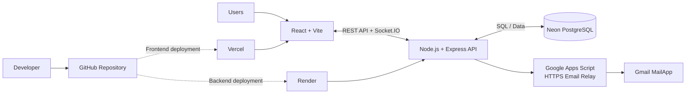

 <div align="center">


# RoomSync

### Find compatible roommates. Discover rooms. Live better together.

A smart, real-time roommate matching and room management platform designed to make shared living simpler.

<p>
  <a href="https://roomsync-web.vercel.app/">🌐 Live Application</a> ·
  <a href="https://github.com/Vignesh-V06/RoomSync-RealTime-Roommate-Matching">📦Source Code</a>
</p>

<p>
  
  
  
  
  
</p>

<p>
  
  
  
  
  
  
</p>

</div>

---

## Overview

**RoomSync** brings roommate discovery, compatibility matching, room management, and real-time communication together in one platform.

Instead of choosing roommates based only on availability, RoomSync helps students discover people whose lifestyle, academic preferences, and living habits align with theirs.

The platform provides dedicated experiences for students, room owners, and administrators.

## Features

| Module | Capabilities |
|---|---|
| **Smart Matching** | Weighted compatibility scoring based on lifestyle, academic and personal preferences, including custom criteria. |
| **Room Discovery** | Explore available rooms, view details, photos and compatibility scores. |
| **Room Management** | Create listings, manage availability, capacity, room photos and roommate memberships. |
| **Applications** | Apply, accept, reject and manage room applications with controlled membership states. |
| **Real-Time Chat** | Room-specific messaging powered by Socket.IO. |
| **Notifications** | Application updates and real-time user notifications. |
| **Secure Authentication** | JWT authentication, bcrypt password hashing, registration OTP and password reset. |
| **Owner Analytics** | Room views, visitors, applications and listing performance. |
| **Admin Dashboard** | Platform analytics, activity tracking, CSV and Excel exports. |

## Architecture

RoomSync uses a React frontend connected to a Node.js backend. PostgreSQL handles application data, while Google Apps Script provides the email delivery relay.



## Technology Stack

| Layer | Technologies |
|---|---|
| Frontend | React, Vite, React Router, Tailwind CSS, Axios |
| Backend | Node.js, Express.js, REST API |
| Real-Time | Socket.IO |
| Database | PostgreSQL, Neon, node-postgres (`pg`) |
| Authentication | JWT, bcrypt |
| Email Delivery | Google Apps Script, Gmail MailApp |
| Hosting | Vercel, Render |
| Version Control | Git, GitHub |

## Project Structure

```text
RoomSync/
├── backend/
│   ├── controllers/
│   ├── db/
│   ├── middleware/
│   ├── routes/
│   ├── scripts/
│   ├── test/
│   ├── utils/
│   ├── schema.postgres.sql
│   ├── server.js
│   ├── socket.js
│   └── package.json
│
├── frontend/
│   ├── public/
│   ├── src/
│   │   ├── components/
│   │   ├── context/
│   │   ├── pages/
│   │   ├── api.js
│   │   ├── socket.js
│   │   └── App.jsx
│   └── package.json
│
└── README.md
```

## Getting Started

### Prerequisites

- Node.js (compatible with Vite 8)
- npm
- Git
- PostgreSQL database access

### 1. Clone the repository

```bash
git clone https://github.com/Vignesh-V06/RoomSync-RealTime-Roommate-Matching.git

cd RoomSync-RealTime-Roommate-Matching
```

### 2. Install dependencies

```bash
cd backend
npm install
```

```bash
cd ../frontend
npm install
```

### 3. Configure environment variables

Create the backend `.env` file using the example:

**Windows PowerShell (from the repository root):**

```powershell
Copy-Item backend/.env.example backend/.env
```

Configure your PostgreSQL connection, authentication secrets, and email provider in `backend/.env`.

Create `frontend/.env`:

```env
VITE_API_BASE_URL=http://localhost:5000/api
VITE_SOCKET_URL=http://localhost:5000
```

### 4. Configure the database

RoomSync uses PostgreSQL with the `roomsync` schema.

```env
DATABASE_URL=YOUR_POSTGRESQL_CONNECTION_STRING
DB_SCHEMA=roomsync
```

For an existing, migrated Neon database, use its existing connection and schema. Do not run the schema initialization again.

For a brand-new, empty PostgreSQL database only:

```bash
psql "$DATABASE_URL" -f backend/schema.postgres.sql
```

Verify database connectivity:

```bash
cd backend
npm run db:check
```

### 5. Configure email delivery

RoomSync uses Google Apps Script as an HTTPS email relay for registration and password-reset OTPs.

Configure these variables in `backend/.env`:

```env
EMAIL_PROVIDER=apps_script
APPS_SCRIPT_EMAIL_URL=YOUR_DEPLOYED_WEB_APP_URL
APPS_SCRIPT_EMAIL_SECRET=YOUR_SHARED_SECRET
```

The secret must match the `ROOMSYNC_MAIL_SECRET` Script Property in the deployed Apps Script project.

Never commit `.env` files or expose email credentials.

### 6. Run the application

**Backend**

```bash
cd backend
npm start
```

**Frontend** — in another terminal:

```bash
cd frontend
npm run dev
```

Open the local URL provided by Vite, usually:

```text
http://localhost:5173
```

## Available Scripts

**Backend**

| Command | Description |
|---|---|
| `npm start` | Start the API and Socket.IO server |
| `npm test` | Run backend tests |
| `npm run db:check` | Verify PostgreSQL configuration |
| `npm run test:postgres` | Run PostgreSQL-specific tests |
| `npm run seed:admin` | Bootstrap an administrator account |

**Frontend**

| Command | Description |
|---|---|
| `npm run dev` | Start the development server |
| `npm run build` | Create the production build |
| `npm run preview` | Preview the production build |
| `npm run lint` | Run ESLint |

## Deployment

| Component | Platform |
|---|---|
| Web Application | Vercel |
| Backend API and Socket.IO | Render |
| Database | Neon PostgreSQL |
| Email Relay | Google Apps Script |

Production configuration is managed through the respective hosting environment variables.

The backend requires the correct PostgreSQL connection, schema, JWT secret, OTP secret, allowed frontend origins and email relay credentials.

## Security

- JWT-protected API routes.
- Password hashing using bcrypt.
- Server-side role and room membership authorization.
- OTPs stored as keyed hashes, with expiration and attempt limits.
- Authenticated Socket.IO connections and room-level access checks.
- Secrets managed through environment variables.
- Administrator endpoints protected by server-side role validation.

## Roadmap

- [x] Room discovery and compatibility matching
- [x] Room owner management and applications
- [x] Real-time room chat and notifications
- [x] PostgreSQL and Neon integration
- [x] Administrator analytics and reporting
- [x] Email OTP verification workflows
- [ ] Complete local and production regression testing
- [ ] Expand automated test coverage
- [ ] Introduce dedicated object storage for room images
- [ ] Further improve matching and analytics capabilities

## Contributing

Contributions and suggestions are welcome.

1. Fork the repository.
2. Create a feature branch.
3. Make and test your changes.
4. Submit a pull request with a clear description.

Keep credentials, private environment files, and production data out of commits.

---

<div align="center">

### RoomSync

**Better matches. Better roommates. Better living.**

Made with care.

</div>
